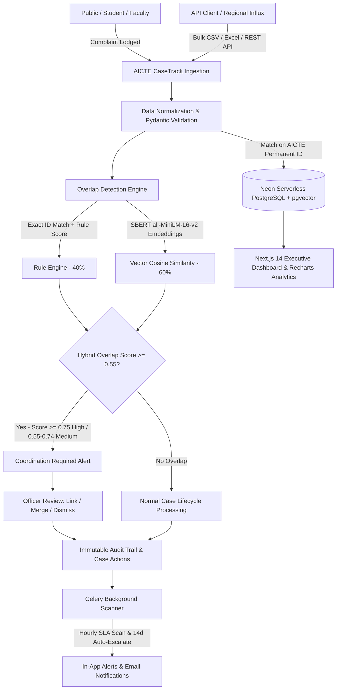

# AICTE CaseTrack
### Integrated Institution Complaint Monitoring & Cross-Bureau Status Dashboard
**Smart India Hackathon 2026 • Problem Statement: PS SIH26264**

AICTE CaseTrack is an enterprise-grade regulatory intelligence web application designed for the All India Council for Technical Education (AICTE). It provides authorized bureau officials, grievance directors, and regional officers with a single-window interface to monitor institutional complaints, track bureau ownership, enforce statutory SLAs, detect duplicate and overlapping inter-bureau cases using hybrid Sentence-BERT NLP, and generate official compliance reports.

---

## 1. System Architecture



---

## 2. Fixed Technology Stack

| Layer | Technology | Details |
|---|---|---|
| **Frontend** | **Next.js 14 (App Router)** | TypeScript, React 18, Tailwind CSS, Lucide React, Recharts |
| **Backend** | **FastAPI + Python 3.12** | Pydantic v2, SQLAlchemy 2.0 (async + sync), Alembic |
| **Database** | **Neon PostgreSQL** | Serverless PostgreSQL with `pgvector` vector extension, HNSW & GIN indexes |
| **NLP Overlap Engine** | **Sentence-BERT** | `all-MiniLM-L6-v2` (384-dim embeddings) + Multi-attribute Rule Engine |
| **Background Jobs** | **Celery + Celery Beat** | Redis broker & in-process eager mode fallback for zero-dependency execution |
| **Security & Auth** | **JWT + Argon2** | Argon2 password hashing, JWT Access (15m) & Refresh (7d), RBAC guards |
| **Reporting** | **ReportLab + OpenPyXL** | Native PDF with `Times-Roman` typography, Excel (`.xlsx`), CSV |

---

## 3. Design System & Accessibility

* **Typography:** System font **Times New Roman** exclusively across all UI screens, tables, Recharts SVG elements, and ReportLab PDF documents (`font-family: "Times New Roman", Times, serif`). Zero external Google Font requests for instant paint.
* **Palette:** Government white and orange theme with strict contrast compliance (WCAG AA 5.2:1):
  * Primary Orange: `#F97316` (Buttons, active tabs, chart fills)
  * Hover / Focus: `#EA580C`
  * Orange on White Text: `#C2410C`
  * Neutral Surface: `#FFFFFF`, Subtle Surface: `#FFF7ED`, Borders: `#FED7AA`
  * Body Text: `#1F2937`, Muted Text: `#6B7280`
  * Status Chips: Orange tints and outlines with distinct icons (Pending, Under Process, Disposed, Transferred, Escalated/Overdue).

---

## 4. Role-Based Access Control (RBAC) & Demo Credentials

| Role | Email | Password | Scope & Privileges |
|---|---|---|---|
| **Admin** | `admin@aicte.gov.in` | `Admin@123456` | Full system control, user approvals, SLA matrix tuning |
| **Senior Manager** | `seniormanager@aicte.gov.in` | `Senior@123456` | Cross-bureau view, auto-escalations, review overlaps |
| **PGRC Officer** | `pgrc.officer@aicte.gov.in` | `Pgrc@123456` | Public Grievance Redressal Cell case operations & reviews |
| **Regulation Bureau** | `rb.officer@aicte.gov.in` | `Rb@123456` | Regulation Bureau case operations & reviews |
| **Regional Office** | `ro.north@aicte.gov.in` | `North@123456` | Northern Region scoped view & regional intake |

---

## 5. Overlap Detection Engine Specification

The overlap engine evaluates inter-bureau complaints lodged against the same institution to prevent duplicate inquiries and conflicting directives.

$$\text{Final Score} = 0.4 \times \text{Rule Score} + 0.6 \times \text{Semantic Score}$$

1. **Candidate Blocking:** Strict exact match on `institutions.aicte_permanent_id` only. No fuzzy institution name guessing.
2. **Rule Score (0 to 1):**
   * Exact AICTE Permanent ID match: $+0.20$
   * Different Bureau / Cell handling: $+0.25$
   * Both cases actively open: $+0.20$
   * Same or related grievance category: $+0.15$
   * Received within 180 days: $+0.10$
   * Same complainant type: $+0.10$
3. **Semantic Score (0 to 1):** Cosine similarity of 384-dimensional vector embeddings generated by `all-MiniLM-L6-v2` over `title + description`. Negative values clamped to $0$.
4. **Thresholds:**
   * $\ge 0.75$: **High Severity**
   * $0.55 - 0.74$: **Medium Severity**
   * $< 0.55$: **No Overlap (Normal Processing)**
5. **Resolution Actions:**
   * **Link:** Keeps both cases live; flags them as cross-bureau coordination cluster.
   * **Merge:** Designates a Primary case and marks secondary cases as `Disposed (Merged)`, preserving all audit trails.
   * **Dismiss:** Requires mandatory officer justification; permanently dismisses the cluster from re-flagging.

---

## 6. Local Setup and Execution (No Docker)

### Prerequisites
* Node.js v20+
* Python 3.11+ / 3.12+
* Neon PostgreSQL (pooled connection string provided in `.env`)

### 1. Backend Setup
```bash
cd backend
python -m venv .venv
# Windows:
.venv\Scripts\activate
# Linux / macOS:
source .venv/bin/activate

pip install -r requirements.txt
cp .env.example .env

# Run database migrations (creates schema + vector extension)
alembic upgrade head

# Seed 5 bureaus, 5 demo users, 60 institutions, 600 cases, and 30 deliberate overlaps
python -m scripts.seed

# Start FastAPI server
uvicorn app.main:app --reload --port 8000
```

### 2. Frontend Setup
```bash
cd frontend
npm install
cp .env.local.example .env.local
npm run dev
```

Visit **`http://localhost:3000`** in your browser.

Alternatively, on Windows double-click **`run.bat`** or on Linux run **`./run.sh`**.

---

## 7. Automated Test Suite

Run pytest in the backend directory:
```bash
cd backend
python -m pytest tests -v
```

**Verification:**
* `tests/test_auth.py`: Argon2 password hashing and JWT encoding/decoding.
* `tests/test_normalization.py`: AICTE Permanent ID uppercase sanitization, whitespace trim, and ISO date parsing.
* `tests/test_overlap.py`: 384-dim SBERT embedding generation, cosine similarity math, and multi-attribute rule scoring.

---

## 8. Interactive Demo Walkthrough Script

1. **Sign In as Regulation Bureau Officer:**
   * Open `http://localhost:3000/login`.
   * Click the quick-fill button **RB Officer** (`rb.officer@aicte.gov.in` / `Rb@123456`) and click **Sign In**.
2. **Review Overlap Alert Banner:**
   * On `/dashboard`, see the prominent alert: **"Potential Overlapping Cases – Coordination Required"**.
   * Note the confidence percentage and rules triggered between Regulation Bureau and PGRC.
3. **Inspect Overlaps Queue:**
   * Navigate to **Overlap Coordination** (`/overlaps`).
   * Compare Case 1 (PGRC) and Case 2 (RB) side-by-side.
   * Click **Link** or **Merge**, enter mandatory officer justification, and confirm.
   * Notice the status updates to `Linked` or `Merged` with an immutable entry in the audit trail.
4. **Filter & Trace Case History:**
   * Open **Cases & Complaints** (`/cases`).
   * Filter by status (`Under Process`), category, or Permanent ID (`1-1002341`).
   * Click any row to view the slide-over drawer; click **Dossier** to see the full chronological timeline.
5. **Run Batch Ingestion:**
   * Navigate to **Data Ingestion** (`/ingest`).
   * Click **Download Official CSV Template**, or upload any batch file.
   * View the validation breakdown (Accepted vs Rejected for invalid AICTE IDs).
6. **Export Statutory Report:**
   * Navigate to **Reports & Analytics** (`/reports`).
   * Select **Bureau-Wise Workload** or **Inter-Bureau Overlaps Audit Trail**.
   * Click **Export Official PDF** to download a print-ready report in Times New Roman typography.
